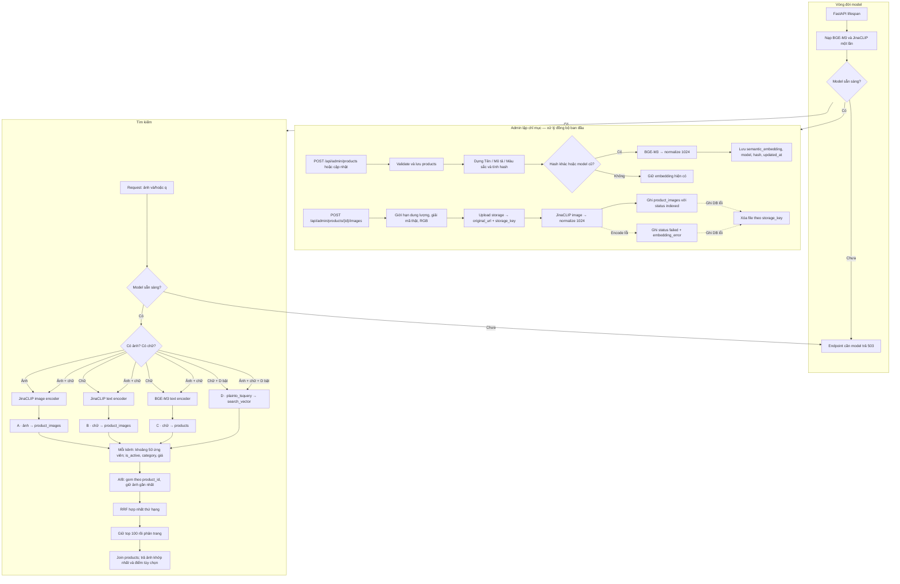

# Danh sách API E-commerce (Single-Vendor)

## 1. Người dùng (Users & Auth)
* **`POST`** `/api/users/sync` - Lưu user từ Firebase vào database (lần đầu đăng nhập).
* **`GET`** `/api/users/me` - Lấy thông tin profile user hiện tại.

## 2. Sản phẩm & Danh mục (Products & Categories)
* **`GET`** `/api/categories` - Lấy danh sách danh mục, có `parent_id` để dựng cây ở frontend.
* **`GET`** `/api/categories/{category_id}` - Lấy thông tin một danh mục theo ID số.
* **`GET`** `/api/products` - Lấy danh sách sản phẩm có phân trang, lọc và sắp xếp.
* **`GET`** `/api/products/search` - Tìm sản phẩm theo chữ bằng embedding và full-text.
* **`POST`** `/api/products/search/image` - Tìm sản phẩm bằng ảnh, có thể kèm từ khóa.
* **`GET`** `/api/products/{id}` - Lấy chi tiết 1 sản phẩm.
* **`CRUD`** `/api/products/{id}/reviews` - Xem/Thêm/Sửa/Xóa đánh giá sản phẩm.

## 3. Giỏ hàng & Yêu thích (Cart & Wishlist)
* **`CRUD`** `/api/cart` - Quản lý giỏ hàng (Xem, Thêm, Sửa số lượng, Xóa sản phẩm).
* **`CRUD`** `/api/users/favorites` - Quản lý danh sách sản phẩm yêu thích (Wishlist).

## 4. Địa chỉ & Đơn hàng (Addresses & Orders)
* **`CRUD`** `/api/users/addresses` - Quản lý sổ địa chỉ giao hàng của user.
* **`CRUD`** `/api/orders` - Quản lý đơn hàng (Tạo đơn mới, Xem lịch sử đơn hàng, Hủy đơn).

## 5. Thanh toán (Payments)
* **`POST`** `/api/orders/{order_id}/pay` - Thanh toán giả lập cho đơn dùng phương thức trực tuyến.
* Thanh toán VNPay/Momo và webhook chưa được tích hợp; đơn COD không dùng endpoint thanh toán giả lập.

## 6. Quản trị viên (Admin - Yêu cầu role 'admin')
* **`CRUD`** `/api/admin/products` - Quản lý sản phẩm và ảnh (`product_images`).
* **`CRUD`** `/api/admin/categories` - Quản lý danh mục.
* **`GET`** `/api/admin/orders` - Xem danh sách toàn bộ đơn hàng.
* **`PATCH`** `/api/admin/orders/{id}/status` - Cập nhật trạng thái đơn hàng (Đang giao, Hoàn thành...).
* **`GET`** `/api/admin/analytics` - Lấy thống kê doanh thu, số đơn bán ra.

## 7. Pipeline tìm kiếm sản phẩm bằng văn bản và hình ảnh

### 7.1. Quy tắc chung

Pipeline dùng hai model và hai không gian vector độc lập ([model card BGE-M3](https://huggingface.co/BAAI/bge-m3), [model card JinaCLIP v2](https://huggingface.co/jinaai/jina-clip-v2)):

| Model/kênh | Đầu vào | Không gian và cột lưu |
| --- | --- | --- |
| BGE-M3 | Văn bản sản phẩm và truy vấn chữ | `products.semantic_embedding` |
| JinaCLIP v2 | Ảnh sản phẩm, ảnh truy vấn và văn bản truy vấn | `product_images.multimodal_embedding` |

- Cả hai loại vector có 1024 chiều, được chuẩn hóa L2 và so sánh bằng cosine. Tạo HNSW index với `vector_cosine_ops` cho từng cột vector.
- Không bao giờ so sánh hoặc cộng trực tiếp vector BGE-M3 với vector JinaCLIP. Chỉ gộp thứ hạng kết quả của các kênh độc lập.
- Ảnh sản phẩm và ảnh truy vấn dùng cùng tiền xử lý: giải mã ảnh, chuyển RGB và thống nhất dùng ảnh gốc hoặc cùng quy tắc crop.
- Embedding sản phẩm được tính khi admin tạo/sửa sản phẩm. Embedding truy vấn chỉ được tính khi có yêu cầu tìm kiếm.
- Nạp hai model đúng một lần trong FastAPI lifespan. Nếu model chưa sẵn sàng, endpoint cần model trả `503`.

Ví dụ khai báo index trong migration PostgreSQL:

```sql
CREATE INDEX ix_products_semantic_embedding_hnsw
    ON products USING hnsw (semantic_embedding vector_cosine_ops);

CREATE INDEX ix_product_images_multimodal_embedding_hnsw
    ON product_images USING hnsw (multimodal_embedding vector_cosine_ops);
```

### 7.2. Lập chỉ mục sản phẩm và ảnh (admin)

**Sản phẩm — `POST /api/admin/products` và cập nhật sản phẩm**

1. Admin gửi dữ liệu; backend kiểm tra hợp lệ rồi lưu bản ghi vào `products`.
2. Dựng văn bản ổn định từ các trường tìm kiếm, ví dụ `Tên: ... Mô tả: ... Màu sắc: ...`, rồi tính hash của chuỗi đó.
3. Chỉ khi hash khác `embedding_text_hash` (hoặc model lưu hiện tại đã cũ), gọi BGE-M3. Chuẩn hóa vector và ghi `semantic_embedding`, `embedding_model`, `embedding_text_hash`, `embedding_updated_at`.
4. Nếu nội dung không đổi và model vẫn hiện hành, giữ vector hiện có, không gọi lại BGE-M3.

**Ảnh — `POST /api/admin/products/{id}/images`**

1. Kiểm tra giới hạn dung lượng, giải mã ảnh thật (không tin tên file hoặc MIME do client gửi) và chuyển ảnh sang RGB.
2. Khi model sẵn sàng, gọi JinaCLIP image encoder với cùng tiền xử lý như ảnh truy vấn và chuẩn hóa vector 1024 chiều.
3. Upload ảnh lên Cloudinary; lưu URL trong `image_url` và khóa file trong `storage_key`.
4. Ghi `product_images` cùng model và trạng thái embedding. Nếu model chưa sẵn sàng, ảnh được lưu ở trạng thái `pending`.
5. Nếu encode lỗi, vẫn lưu ảnh với `embedding_status = 'failed'` và `embedding_error`.
6. Nếu ghi DB lỗi sau khi upload, xóa file vừa upload theo `storage_key`.

Giai đoạn đầu, thực hiện đồng bộ trong request để đơn giản. Khi thời gian xử lý trở thành vấn đề, chuyển công việc embedding sang `BackgroundTasks` hoặc worker. Một job backfill/retry cần quét ảnh có `embedding_status <> 'indexed'` và sản phẩm có hash lệch hoặc `embedding_model` cũ.

### 7.3. Tìm kiếm và hợp nhất kết quả

Có bốn kênh tìm kiếm. Mỗi kênh lấy khoảng 50 ứng viên sau khi áp dụng `is_active`, category và khoảng giá:

| Kênh | Đầu vào | Model/phép tìm | So với |
| --- | --- | --- | --- |
| A | Ảnh truy vấn | JinaCLIP image encoder | `product_images.multimodal_embedding` |
| B | Chữ truy vấn | JinaCLIP text encoder | `product_images.multimodal_embedding` |
| C | Chữ truy vấn | BGE-M3 | `products.semantic_embedding` |
| D | Chữ truy vấn | `plainto_tsquery` (tùy chọn) | `products.search_vector` |

Chọn kênh theo loại yêu cầu:

- Chỉ ảnh (`POST /api/products/search/image` không có `q`): A.
- Ảnh kèm chữ: A, B, C; thêm D nếu bật tìm kiếm full-text.
- Chỉ chữ (`GET /api/products/search` hoặc endpoint tìm kiếm chữ khác): B, C, D.

Ở kênh A và B, một sản phẩm có thể có nhiều ảnh. Trước khi xếp hạng sản phẩm, gom kết quả ảnh về một dòng cho mỗi `product_id` bằng cách giữ ảnh giống nhất, chẳng hạn `DISTINCT ON (product_id)` hoặc `MIN(distance) GROUP BY product_id`.

Gộp thứ hạng các kênh bằng Reciprocal Rank Fusion (RRF):

```python
def rrf(rankings: list[list[str]], k: int = 60) -> list[str]:
    scores: dict[str, float] = {}
    for ranking in rankings:  # mỗi kênh là product_id đã sắp theo độ giống
        for rank, pid in enumerate(ranking, start=1):
            scores[pid] = scores.get(pid, 0) + 1 / (k + rank)
    return sorted(scores, key=scores.get, reverse=True)
```

Phân trang sau khi gộp: lấy khoảng top 100 sản phẩm theo RRF rồi mới cắt trang. Cuối cùng join `products` và trả sản phẩm, ảnh khớp nhất cùng điểm nếu muốn công khai điểm.

### 7.4. Sơ đồ pipeline



### 7.5. Ví dụ gửi ảnh truy vấn

`POST /api/products/search/image` nhận `multipart/form-data` với field `file` và field `q` tùy chọn. Frontend gửi `Blob`/`File` trực tiếp trong `FormData`, không gửi base64 trong JSON:

- Backend kiểm tra dung lượng và giải mã nội dung ảnh thật, chuyển RGB, rồi áp dụng đúng tiền xử lý ảnh đã dùng khi lập chỉ mục. Không tin tên file hoặc MIME client gửi.
- Ảnh truy vấn được embed theo request và không lưu thành embedding sản phẩm. Nếu có `q`, chạy thêm các kênh chữ B và C (cùng D nếu bật); nếu không có ảnh thì dùng B, C, D.

```javascript
const form = new FormData();
form.append("file", imageBlob, "query.jpg");
form.append("q", "áo khoác màu be, dáng rộng"); // tùy chọn

const response = await fetch("/api/products/search/image", {
  method: "POST",
  body: form,
  headers: { Authorization: `Bearer ${token}` },
});
```

Không tự đặt `Content-Type: multipart/form-data`; trình duyệt cần tự thêm multipart boundary.